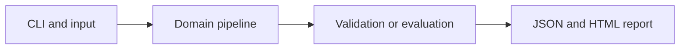

# Evidence Research Workflow

Run explicit retrieve, draft and verify stages with source-linked observations and a bounded context.

**Category:** Agentic AI / RAG

**Execution:** Fixture replay by default; optional actual local-LLM generation. Live integration is implemented but not verified in this build.

## Run

```sh
python -m venv .venv
# Windows: .venv\Scripts\activate
# macOS/Linux: source .venv/bin/activate
python -m pip install -r requirements.txt
python app.py
python -m unittest discover -v
```

Open `results/report.html` after running. Python 3.10+ is required. Use `--help` for input and seed options.

For actual generation with a running Ollama installation and downloaded model:

```sh
python app.py --mode live --model YOUR_INSTALLED_MODEL
```

Model installation is separate and may require substantial memory. No silent fallback to fixtures is used. See [Ollama generation API](https://docs.ollama.com/api/generate) and [structured outputs](https://docs.ollama.com/capabilities/structured-outputs).

## Architecture



## Algorithm

A fixed state graph retrieves up to three relevant passages, drafts a structured brief and verifies each evidence quote is a literal substring of its cited retrieved passage. Live drafting uses a local LLM; fixture mode exercises the graph with replayed drafting output.

## Evaluation

Inject invalid quotes and unknown sources to test rejection. Record all stage outputs for review. This is a deterministic workflow with an optional LLM drafting stage, not multiple autonomous agents.

## Limitations

An exact quote proves the text was present but cannot prove the surrounding interpretation or completeness. Context instructions are untrusted; the generator must not select tool permissions.

## Documentation

- [PDF project guide](PROJECT_GUIDE.pdf)
- [Editable guide](GUIDE.md)
- [Model and system card](MODEL_CARD.md)
- [Measured results](results/metrics.json)
- [Test output](TEST_RESULTS.txt)

## Extend it

Add independent claim support evaluation, contradictory sources, retry policies, query planning and licensed source ingestion.

AI-assisted educational project with synthetic data. Review, customize and explain your own contribution accurately. MIT license.
